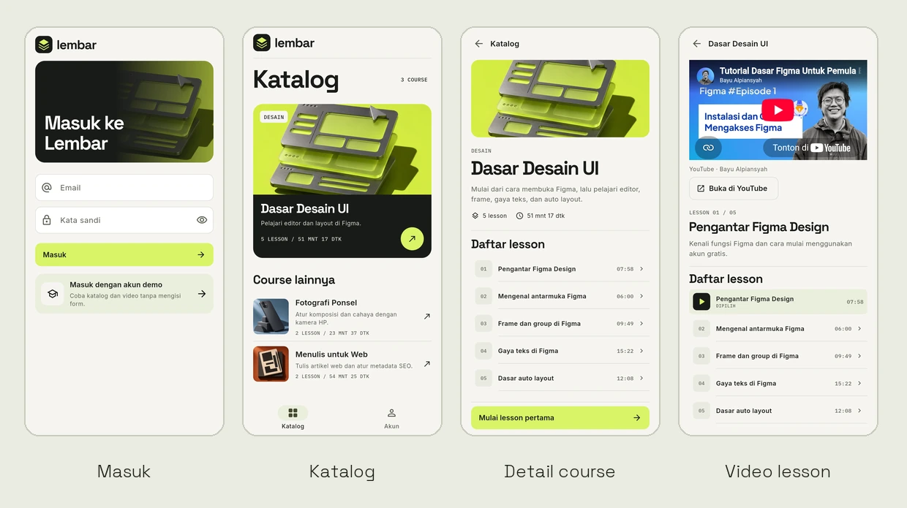
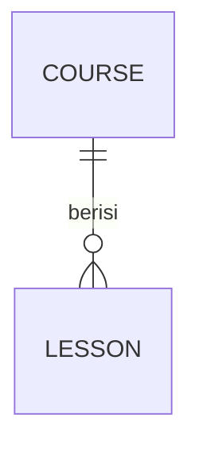

# E-LEARNING-PLATFORM

**Lembar** adalah aplikasi Flutter untuk Student pada Technical Assessment Track B. Student dapat menjelajahi tiga course, melihat daftar lesson berurutan, dan menonton sembilan video berbahasa Indonesia.



[Desain Figma](https://www.figma.com/design/5gs2WKfTLrd0i4a5kdvDUV/Lembar-Simple-E-Learning?node-id=8-662) · [Prototipe Student](https://www.figma.com/proto/5gs2WKfTLrd0i4a5kdvDUV/Lembar-Simple-E-Learning?node-id=8-703&starting-point-node-id=8-703)

## Menjalankan aplikasi

Gunakan Flutter 3.47.5 dan Dart 3.13.4 sebagai versi acuan. Siapkan Android SDK dan perangkat Android 7.0 (API 24) atau lebih baru, atau Xcode dan perangkat maupun simulator iOS 15 atau lebih baru.

```sh
git clone https://github.com/rikoarik/E-LEARNING-PLATFORM.git
cd E-LEARNING-PLATFORM
flutter pub get
flutter devices
flutter run -d DEVICE_ID
```

Pilih **Masuk dengan akun demo**. Jika ingin mencoba form, gunakan email `student@lembar.example` dan kata sandi `lembar-demo`. Demo memakai [katalog JSON lokal](assets/data/courses.json) dan bisa dijalankan tanpa server, API key, atau konfigurasi tambahan.

Untuk membuat APK demo Android ARM64, jalankan `flutter build apk --debug --target-platform android-arm64`. Hasil build tersedia di `build/app/outputs/flutter-apk/app-debug.apk`.

### Alur demo

1. Buka **Katalog → Dasar Desain UI** untuk melihat deskripsi, durasi, dan urutan lesson.
2. Pilih **Mulai lesson pertama**, lalu gunakan kontrol putar, jeda, dan seek di pemutar YouTube.
3. Pilih **Mengenal antarmuka Figma** dari daftar di layar video. Gunakan tombol kembali untuk menuju detail, lalu katalog.
4. Tarik katalog atau detail ke bawah untuk memuat ulang. Jika embed gagal, gunakan **Coba lagi** atau **Buka di YouTube**.

## Rancangan sistem

Flutter menangani UI, Riverpod mengelola sesi dan state katalog, dan `go_router` mengatur navigasi berdasarkan ID course dan lesson. `CourseRepository` memisahkan sumber data dari UI. Saat lesson berganti atau layar ditutup, controller video lama dilepas.



- [ERD dan aturan data](docs/ERD.md) memuat atribut entitas, relasi, dan sesi Student.
- [Rancangan sistem](docs/SYSTEM-DESIGN.md) memuat arsitektur Flutter, kontrak JSON dan API, serta alur pemilihan dan pemutaran lesson.

## Asumsi dan batasan

- Katalog dan akun demo tersedia secara lokal. Sesi berakhir ketika Student keluar atau proses aplikasi ditutup. Cakupan proyek adalah aplikasi Student dengan katalog bersama dan tanpa penyimpanan progres.
- Video diputar langsung lewat embed YouTube. Pemutaran bergantung pada koneksi, wilayah, dan ketersediaan embed. Subtitle mengikuti video masing-masing.
- Prototipe Figma memperagakan navigasi. Kontrol media berfungsi di aplikasi Flutter.

## Pengujian

```sh
flutter analyze
flutter test
flutter test integration_test/student_flow_test.dart -d DEVICE_ID
```

Tes integrasi memeriksa pemetaan lesson ke video, pergantian controller, serta penanganan video yang gagal dimuat dan percobaan ulang. Gunakan perangkat yang terhubung ke internet untuk menjalankannya.
