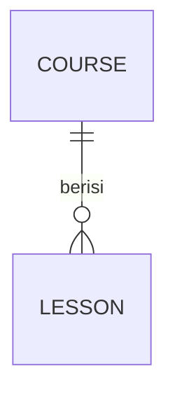

# E-LEARNING-PLATFORM

**Lembar** adalah aplikasi Flutter untuk Student pada Technical Assessment Track B. Student dapat menjelajahi tiga course, melihat daftar lesson berurutan, dan menonton sembilan video berbahasa Indonesia.

**[Unduh APK Android dari GitHub Releases](https://github.com/rikoarik/E-LEARNING-PLATFORM/releases/latest)**


[Desain Figma](https://www.figma.com/design/5gs2WKfTLrd0i4a5kdvDUV/Lembar-Simple-E-Learning?node-id=8-662) · [Prototipe Student](https://www.figma.com/proto/5gs2WKfTLrd0i4a5kdvDUV/Lembar-Simple-E-Learning?node-id=8-703&starting-point-node-id=8-703)

## Menjalankan aplikasi

Gunakan Flutter 3.50.0 stable dengan Dart 3.14.0 bawaan SDK. Siapkan Android SDK dan perangkat Android 7.0 (API 24) atau lebih baru, atau Xcode dan perangkat maupun simulator iOS 15 atau lebih baru.

```sh
git clone https://github.com/rikoarik/E-LEARNING-PLATFORM.git
cd E-LEARNING-PLATFORM
flutter pub get
flutter devices
flutter run -d DEVICE_ID
```

Pilih **Masuk dengan akun demo**. Jika ingin mencoba form, gunakan email `student@lembar.example` dan kata sandi `lembar-demo`. Demo memakai [katalog JSON lokal](assets/data/courses.json) dan bisa dijalankan tanpa server, API key, atau konfigurasi tambahan.

Untuk membuat APK lokal, jalankan `flutter build apk --debug`. Gradle menyalin APK dengan nama aplikasi dan versi ke `build/app/outputs/named-apk/debug/`. Untuk build release, gunakan `flutter build apk --release` dan lihat folder `build/app/outputs/named-apk/release/`.

Jika versi debug sudah terpasang, Android mengharuskan versi itu dihapus sebelum memasang APK dari GitHub karena sertifikatnya berbeda.

### Alur demo

1. Buka **Katalog → Dasar Desain UI** untuk melihat deskripsi, durasi, dan urutan lesson.
2. Pilih **Mulai lesson pertama**, lalu gunakan kontrol putar, jeda, dan seek di pemutar YouTube.
3. Pilih **Mengenal antarmuka Figma** dari daftar di layar video. Gunakan tombol kembali untuk menuju detail, lalu katalog.
4. Tarik katalog atau detail ke bawah untuk memuat ulang. Jika embed gagal, gunakan **Coba lagi** atau **Buka di YouTube**.

## Rancangan sistem

Flutter menangani UI, Riverpod mengelola sesi dan state katalog, dan `go_router` mengatur navigasi berdasarkan ID course dan lesson. `CourseRepository` memisahkan sumber data dari UI. Saat lesson berganti atau layar ditutup, controller video lama dilepas.



- [ERD dan aturan data](docs/ERD.md) memuat atribut entitas, relasi, dan sesi Student.
- [Rancangan sistem](docs/SYSTEM-DESIGN.md) memuat arsitektur Flutter, kontrak JSON dan API, serta alur pemilihan dan pemutaran lesson.

## Asumsi dan batasan

- Katalog dan akun demo tersedia secara lokal. Sesi berakhir ketika Student keluar atau proses aplikasi ditutup. Cakupan proyek adalah aplikasi Student dengan katalog bersama dan tanpa penyimpanan progres.
- Video diputar langsung lewat embed YouTube. Pemutaran bergantung pada koneksi, wilayah, dan ketersediaan embed. Subtitle mengikuti video masing-masing.
- Prototipe Figma memperagakan navigasi. Kontrol media berfungsi di aplikasi Flutter.

## Pengujian

```sh
flutter analyze
flutter test --coverage
flutter test integration_test/student_flow_test.dart -d DEVICE_ID
```

- **Unit test** memeriksa aturan data course dan lesson, sumber media, serta validasi login dan logout. [Tes repository](test/courses/data/course_repository_test.dart) · [Tes sesi demo](test/auth/demo_session_test.dart)
- **Widget test** menjalankan alur Student dan memeriksa keadaan loading, gagal, kosong, dan retry pada UI. [Tes navigasi dan tampilan Student](test/app/student_navigation_test.dart)
- **Tes integrasi** memeriksa pemetaan sembilan lesson ke video, pergantian controller, serta penanganan video gagal dan retry. Jalankan di perangkat yang terhubung ke internet. [Tes alur Student](integration_test/student_flow_test.dart)

`flutter test` menjalankan unit dan widget test. Opsi `--coverage` juga menulis laporan cakupan baris ke `coverage/lcov.info`.

## Rilis Android

[GitHub Actions](.github/workflows/android.yml) menjalankan analisis, unit test, widget test, dan build APK pada pull request serta push ke `main`. Tag `vX.Y.Z` yang cocok dengan versi di `pubspec.yaml` memicu rilis publik berisi APK universal bertanda tangan dan checksum SHA-256.

Untuk rilis berikutnya, naikkan versi dan build number di `pubspec.yaml`, push commit ke `main`, lalu push tag versi yang cocok. Workflow memakai `ANDROID_KEYSTORE_BASE64` dan `ANDROID_KEYSTORE_PASSWORD` dari GitHub Secrets. Gunakan keystore rilis yang sama agar pengguna bisa memasang update.
