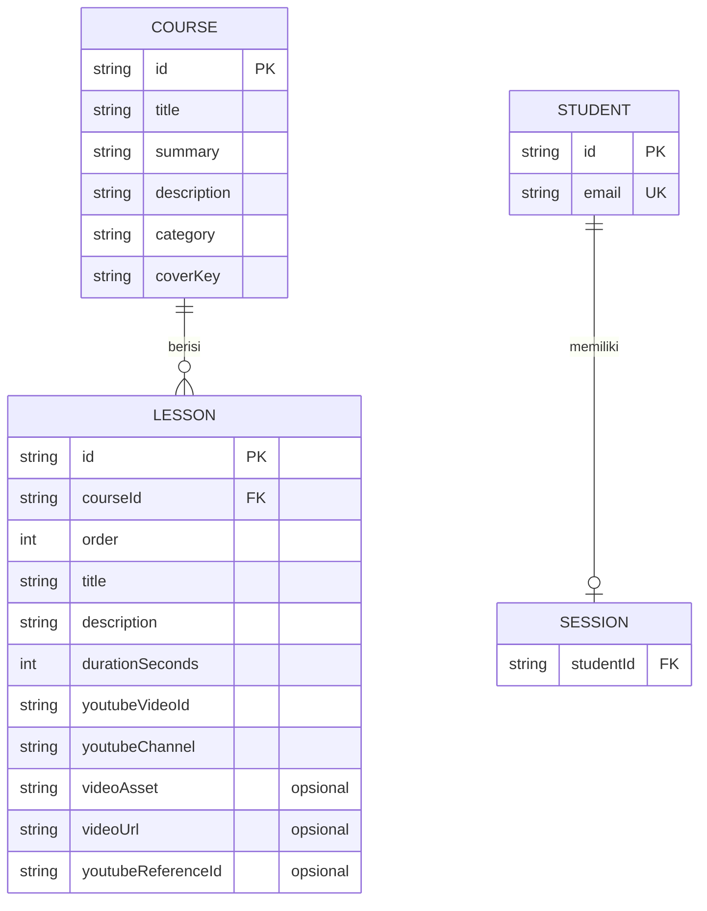

# ERD Lembar

Model logis katalog yang dimuat dari [fixture JSON](../assets/data/courses.json) dan sesi demo dalam memori.

- `Lesson.courseId` harus cocok dengan course induk. ID lesson unik dalam katalog. `order` positif dan unik per course. Jumlah lesson dan durasi course dihitung dari daftar lesson.
- Kesembilan lesson demo memakai `youtubeVideoId` dan menyertakan atribusi `youtubeChannel`. Repository juga mendukung sumber MP4 melalui `videoAsset` atau `videoUrl` HTTPS. `youtubeReferenceId` dapat menyimpan tautan referensi terpisah.
- Sesi direpresentasikan sebagai `Student?` dalam satu provider. Semua sesi demo mengakses katalog yang sama. Data enrollment dan progres berada di luar model demo.

[Rancangan sistem dan kontrak data](SYSTEM-DESIGN.md)
