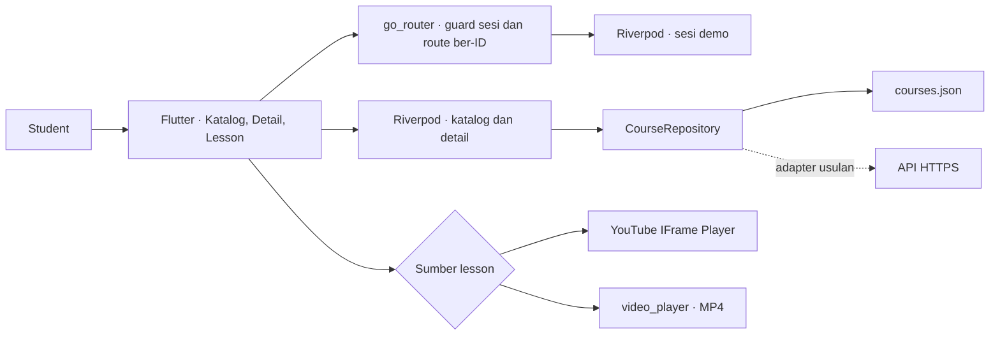
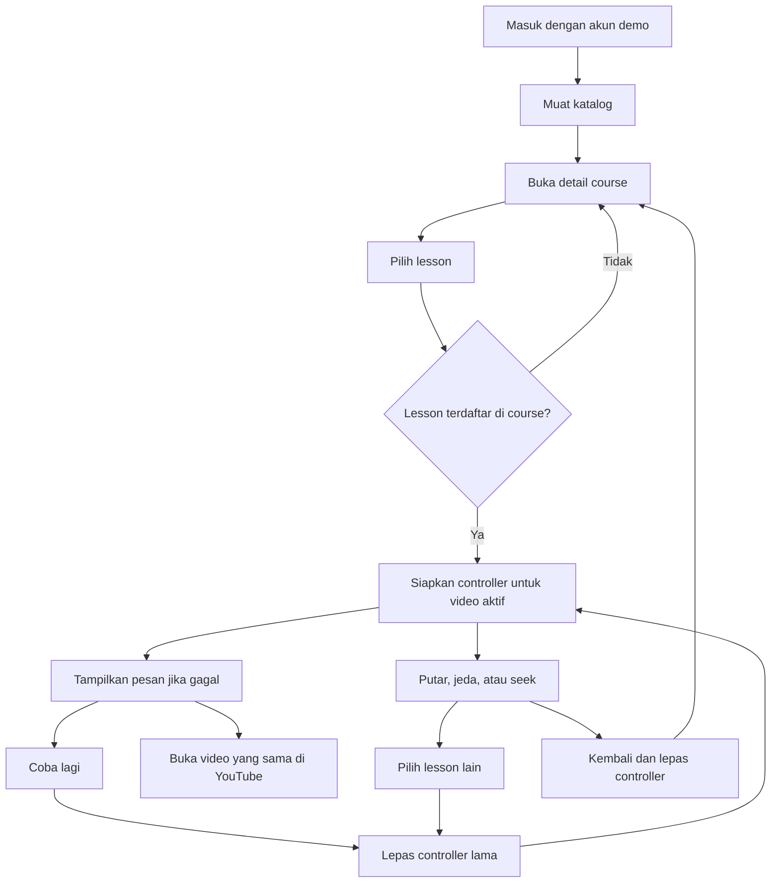

# Rancangan sistem Lembar

[README](../README.md) · [ERD](ERD.md)

## Komponen dan aliran data



| Direktori di `lib/` | Tanggung jawab |
| --- | --- |
| `app/`, `auth/` | Tema, navigasi, guard sesi, serta masuk dan keluar akun demo. |
| `courses/` | Repository memvalidasi fixture dan membentuk model. Provider Riverpod memberi UI state loading, data, kosong, error, dan retry. |
| `player/` | Layar lesson memilih pemutar dari sumber video. Panel YouTube dipakai oleh katalog demo. `VideoSession` menangani siklus hidup MP4. |
| `shared/ui/`, `l10n/` | Komponen bersama dan teks UI berbahasa Indonesia. |

## Kontrak data

[Fixture demo](../assets/data/courses.json) memuat objek `data` berisi daftar course. Setiap course memiliki `id`, `title`, `summary`, `description`, `category`, `coverKey`, dan `lessons[]`. Ini salah satu objek lesson di fixture.

```json
{
  "id": "pengantar-figma-design",
  "courseId": "dasar-desain-ui",
  "order": 1,
  "title": "Pengantar Figma Design",
  "description": "Kenali fungsi Figma dan cara mulai menggunakan akun gratis.",
  "durationSeconds": 478,
  "youtubeVideoId": "OgNq2UYpf2o",
  "youtubeChannel": "Bayu Alpiansyah"
}
```

| Metode repository | Endpoint usulan | Respons |
| --- | --- | --- |
| `listCourses()` | `GET /v1/courses` | `{"data": [...]}` dengan ringkasan course, `lessonCount`, dan `totalDurationSeconds`. Katalog kosong mengembalikan `{"data":[]}`. |
| `getCourse(courseId)` | `GET /v1/courses/{courseId}` | `{"data": {...}}` dengan deskripsi dan `lessons[]`. Course tanpa materi mengembalikan `lessons: []`. |

Untuk memakai API, implementasikan `CourseRepository` dengan adapter HTTP dan pasang melalui `courseRepositoryProvider`. Petakan 404 ke `notFound`, kegagalan koneksi atau timeout ke `offline`, 5xx ke `unavailable`, dan respons yang gagal divalidasi ke `invalidData`.

## Alur Student dan video



Saat aplikasi tidak aktif, player dijeda. Keluar dari layar atau berganti lesson melepas controller serta langganan event lama. Pemutar YouTube memerlukan internet. Pemutar MP4 dapat menerima aset lokal atau URL HTTPS sesuai data lesson. Untuk fixture MP4, `LESSON_VIDEO_BASE_URL` dapat mengarahkan sumber ke `<base>/<lessonId>.mp4`.

## UI

Tema terang memakai latar hangat dan lime untuk aksi utama. Judul menggunakan Space Grotesk, isi menggunakan Inter, dan metadata menggunakan IBM Plex Mono. Layar memakai margin 20 dp dan lebar konten maksimum 600 dp. Pada layar pendek atau dengan teks besar, tombol utama detail ikut bergulir bersama konten. [Layar dan komponen Figma](https://www.figma.com/design/5gs2WKfTLrd0i4a5kdvDUV/Lembar-Simple-E-Learning?node-id=8-662)
